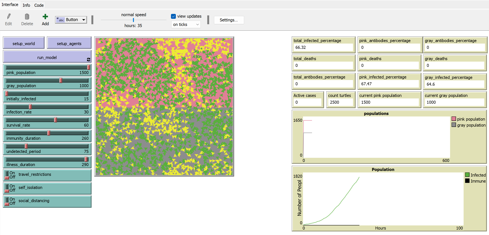
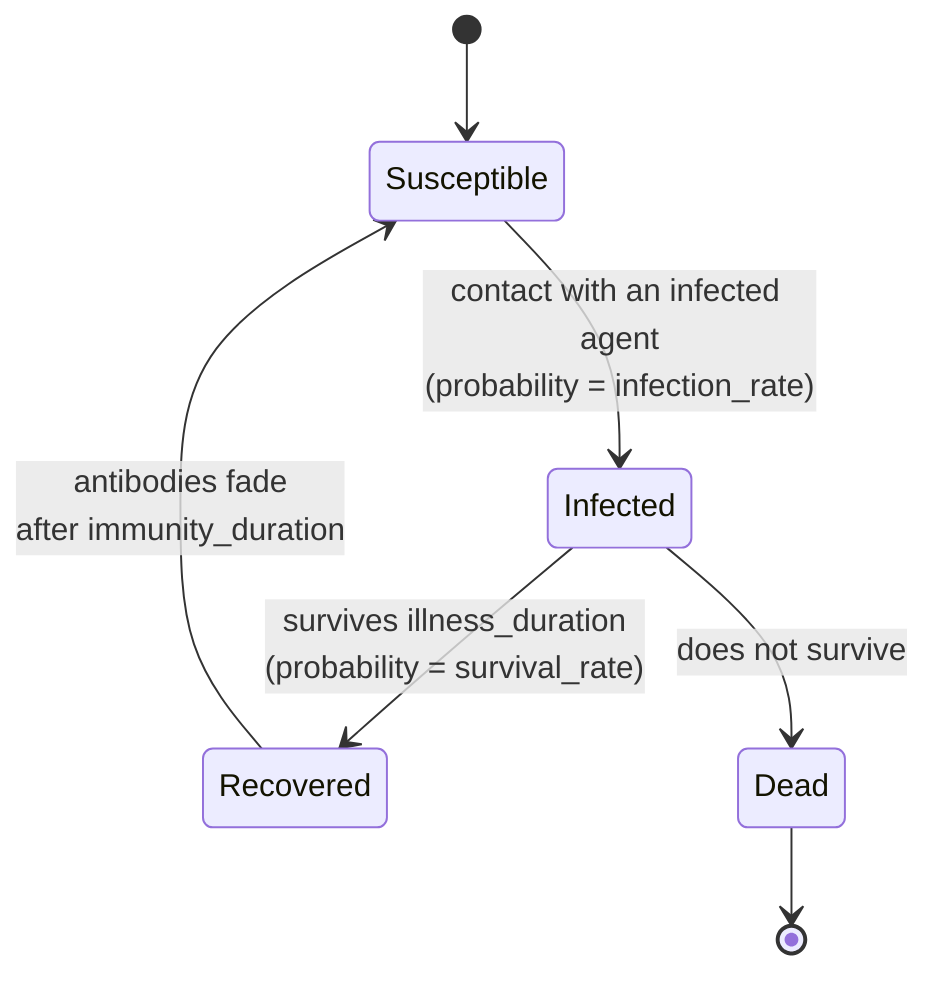

# 🦠 Disease Spread — Agent-Based Model

**A NetLogo simulation of how an infection spreads between two populations, and how travel restrictions, social distancing and self-isolation change the outcome**

---

## 📌 Overview

Each person in the simulation is an independent agent (a NetLogo *turtle*). Agents live in one of two regions — **pink** and **gray** — move around, meet each other, become infected, recover with antibodies, lose immunity over time, or die. Population-level behaviour such as infection waves and herd immunity emerges from these individual rules.

The model was built to answer policy-style questions:

- Which intervention reduces infections the most, and which the least?
- Which population suffers the highest mortality, and which becomes most immune?
- How does population density change the speed of an outbreak?

## 🧠 How the model works

**Agent rules**

- **Movement** — agents wander with small random turns; *travel restrictions* steer them back into their own colour region; *social distancing* makes them turn away when another agent is within 1 patch.
- **Transmission** — an infected agent can infect susceptible agents within a radius of 1 patch, with probability `infection_rate`.
- **Undetected period** — agents are infectious for `undetected_period` ticks before they know they are ill; with *self-isolation* on, agents in that window are isolated (shown in blue).
- **Recovery & immunity** — survivors gain antibodies that last `immunity_duration` ticks.

## 🎛 Controls

| Type | Name | Purpose |
|---|---|---|
| Button | `setup_world` | Reset ticks and draw the two regions |
| Button | `setup_agents` | Create the pink and gray populations and seed infections |
| Button | `run_model` | Run the simulation (forever button) |
| Slider | `pink_population`, `gray_population` | Size of each population |
| Slider | `initially_infected` | Number of agents infected at the start |
| Slider | `infection_rate` | Chance of transmission per contact |
| Slider | `survival_rate` | Chance an infected agent recovers |
| Slider | `illness_duration`, `undetected_period`, `immunity_duration` | Disease timing (ticks) |
| Switch | `travel_restrictions`, `social_distancing`, `self_isolation` | Interventions |
| Monitors / plots | infected %, deaths, antibodies % — total, pink and gray | Live outcomes |

## ▶️ Run it

1. Install [NetLogo](https://ccl.northwestern.edu/netlogo/download.shtml) (6.x).
2. Open **`final Model with comment.nlogo`** (the fully commented final version).
3. Click `setup_world` → `setup_agents` → `run_model`.
4. Toggle the intervention switches and compare the infected %, deaths and antibody monitors.

### 🔬 Experiments to try

| Experiment | Change | What to watch |
|---|---|---|
| Baseline | all switches off | size and timing of the first wave |
| Border closure | `travel_restrictions` on | does the gray region stay protected? |
| Distancing | `social_distancing` on | flatter, later peak |
| Isolation | `self_isolation` on, vary `undetected_period` | how much hidden spread matters |
| Density | raise both population sliders | faster spread, higher peak |

## 🗂 Repository structure

| File | Description |
|---|---|
| `final Model with comment.nlogo` | ✅ final submitted model, fully commented |
| `v2 Assignment Agent Based Modeling.nlogo` | second iteration |
| `Assignment Agent Based Modeling.nlogo` | first working version |
| `01. oil spill projct` | warm-up NetLogo model of oil seeping through soil layers (open in NetLogo's Code tab) |
| `ABM.png` | interface screenshot |

## 🔭 Possible extensions

- Vaccination campaigns and quarantine zones.
- More than two regions with different densities.
- BehaviorSpace sweeps exported to CSV for statistical comparison of interventions.

## 👤 Author

**S M Mahamudul Hasan** — MSc Artificial Intelligence and Robotics, University of Hertfordshire

